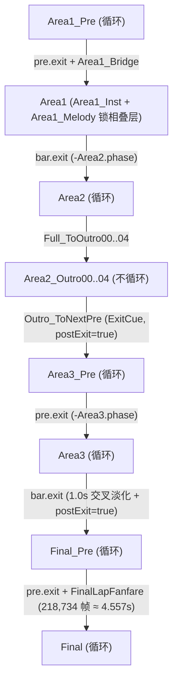

# 《马力欧卡丁车 世界》音乐衔接机制详解

本文档面向音频工程开发者与原声爱好者，结合 JukeKart 源码与实测数据，系统说明《马力欧卡丁车 世界》（*Mario Kart World*）的动态配乐结构、拍点/相位对齐模型、赛内阶段切换、特殊赛道编排、跨赛道路线连程以及无接缝实时播放的底层实现。

---

## 1. 为什么《马力欧卡丁车 世界》的配乐不是“一首完整的 MP3”

在《马力欧卡丁车 世界》中，赛道音乐并不是按固定顺序烘焙好的单一音轨，而是拆分为一组可由运行时按比赛进度与乐句拍线动态编排的 **BWAV 音频片段（stems）**。一条常规赛道通常包含 **5～8 个独立文件**：

- **前奏（`Pre_Short` / `Pre`）**：入场与开跑前循环段，直到正式进入主赛道。
- **过渡桥段（`Bridge`）**：连接前奏与主旋律的短桥段（并非所有赛道都有，且分为“序列桥段”与“叠层桥段”两类）。
- **主循环（`Full` / `Main`）**：比赛主体音乐，具备带前导引子的循环窗口。
- **最终圈加速版（`Fast` / `FL`）**：独立的编曲与音频资产（不是简单调快采样率）。
- **多个冲线尾奏（`Outro00`～`Outro07`）**：对应主旋律不同乐句位置的专属收尾，让玩家无论在曲中哪个乐句冲线，都能在最近的拍点自然收束。

以 `BGM_Stage_Coaster` 实测数据为例（48 kHz 立体声）：

| 角色 | 文件示例 | 采样帧数 | 时长 | 循环窗口（帧） |
|---|---|---:|---:|---|
| `Pre_Short` | `BGM_Stage_Coaster_Pre_Short.bwav` | 534,857 | 11.143 s | `205,714 .. 534,857` |
| `Pre` | `BGM_Stage_Coaster_Pre.bwav` | 2,427,426 | 50.571 s | `452,571 .. 2,427,426` |
| `Bridge` | `BGM_Stage_Coaster_Bridge.bwav` | 88,320 | 1.840 s | 无 |
| `Full`（Main） | `BGM_Stage_Coaster.bwav` | 3,373,711 | 70.286 s | `493,714 .. 3,373,711` |
| `Outro00` | `BGM_Stage_Coaster_Outro00.bwav` | 226,286 | 4.714 s | 无 |

JukeKart 并不靠“猜毫秒数”或直接做生硬淡入淡出来拼接，而是综合三层可核实的依据驱动原生 C++ 音乐图引擎：

1. **BWAV 音频头**：声道、采样率、编码格式与精确到单采样的硬循环窗口（`loopStart` / `loopEnd`）。
2. **Nintendo BARS `MINF` 元数据**（`assets/interactive_minf.json`，覆盖 30 条赛道共 328 条记录）：精确 BPM、相位抢拍（`phase`）、逐拍拍线（`beats`）以及具名转场事件标记（`events`）。
3. **实测参考录音校准**：对于游戏中由逻辑触发但 `MINF events` 为空的转场（例如通用最终圈号角 `BGM_Seq_FinalLapFF`、彩虹之路 `FinalLapFanfare -> Final`、各赛道 `Full -> Outro` 触发点），通过 48 kHz 波形互相关精对齐并固化在目录表中。

---

## 2. 底层时间坐标：BWAV 硬循环真相与 MINF 拍点模型

### 2.1 BWAV 循环窗口的实测结论

对全部 20,991 个 BWAV 文件（其中 174 个带循环标记的 BGM 文件）的逐采样测量揭示了一个常被误解的事实（详见 `docs/research/2026-11-15-bwav-loop-seams.md`）：

- **循环终点之后没有任何冗余音频**：174 / 174 个循环 BGM 均满足 `frames == loop_end`，物理上不存在“写在 `loop_end` 之后的尾部接缝”。
- **BWAV 循环头与 MINF 循环窗口 100% 逐帧一致**：全部 106 个可关联 MINF 的循环 BGM，两者的 `(loopStart, loopEnd)` 误差均为 `0` 帧。
- **循环点并非“可裁切的衔接余量”**：循环终点前与循环起点的波形相似度仅有 4 个文件超过 0.80 且长度均 ≤ 15.5 ms（编码对齐窗口），循环起点前的音频是正常的前置引子。
- **编码细节**：BWAV 支持三种编码——Codec `0`（平面 PCM16）、Codec `1`（Nintendo DSP-ADPCM，含部分文件末块截断与解码历史预测种子校验）、Codec `2`（分块 CELT-only Opus，每帧 `960` 采样，配置块声明 `120` 采样 = 2.5 ms pre-skip）。

因此，**循环无接缝的关键不在“裁剪音源”**，而在于：
1. 严格按 `(loopStart, loopEnd)` 逐采样回绕（并保留 DSP-ADPCM 历史状态与准确 pre-skip）；
2. 在引擎侧提前预取循环起点数据页，防止后台/熄屏下因解码延迟出现 0 采样空洞；
3. 需要切换曲段时，依托 MINF 拍线和转场时间轴完成相位对齐与留尾重叠。

### 2.2 MINF 的四个核心要素

每条 `MinfRecord`（定义于 `interactive/MinfCatalog.kt`）包含四个驱动衔接的关键字段：

| 字段 | 含义 | 在衔接中的作用 |
|---|---|---|
| `bpm` / `rate` | 速度与采样率（48,000 Hz） | 换算淡入淡出拍数（如 1 秒 = `bpm / 60` 拍）与拍线时长 |
| `phase` | **抢拍 / 前置偏移**（采样帧数） | 第 1 个强拍（音乐零点）之前的前置引子长度；目标段提前 `phase` 帧启动即可使强拍精准对齐切出点 `G` |
| `beats` | 逐拍时间戳列表 `(frame, label)` | `label ∈ {-4..-1, 1..4}`，其中 **`label == 1` 表示小节第 1 拍（强拍）**；落于 `[loopStart, loopEnd]` 内的 `label == 1` 构成循环内可切出候选集合 `loopCandidates` |
| `events` | 具名事件采样点字典 | 声明精确的结构交接坐标（见下表） |

主要具名 `MINF` 事件标记：

- `Bridge_ToFull`：桥段交接给主旋律的采样点。
- `Full_FromBridge` / `Full_SkipForBridge`：主旋律承接桥段时的源入点（可为 `0` 或非零采样，显式跳过主旋律自带的重复引子）。
- `Full_ToOutro00`～`Full_ToOutro07`：主旋律通往各编号尾奏的切出点。
- `Outro_ToNextPre`：尾奏交接给下一赛道前奏的退出点（支持分组命名如 `Outro00020305`，并内置岩浆赛道 `Lava Outro01 -> Outro00` 回退匹配）。

---

## 3. 核心转场引擎：`TransitionTimeline` 四元组与同步点

JukeKart 的原生 C++ 引擎（`engine/native/runtime/RuntimeTransitions.cpp`）以 **音乐图（Music Graph，二进制协议 `P2G1`，含 `TransitionTimeline` 时升级至版本 14）** 统一表达所有衔接。

一次转场由 **同步点（`SyncPoint`）** 确定源曲段的切出基准帧 `G`（`sourceSync`），再由 **`TransitionTimeline`** 四元组定义相对于 `G` 的精确采样级调度：

```
时间轴（以源曲段同步点 G = sourceSync 为 0 点）：

  G + bridgeStart       G (sourceSync)         G + destinationStart    G + destinationCommit
       │                     │                          │                       │
───────┼─────────────────────┼──────────────────────────┼───────────────────────┼────▶
       ▼                     ▼                          ▼                       ▼
  [桥段启动]             [源段离开]               [目标段开始发声]         [目标段正式提交]
  (若存在 Bridge)        (若 postExit=true        (支持负偏移提前抢拍，     (成为新的主前台段，
                          则继续留尾衰减)          从 destinationSource     旧段淡出或自然结束)
                                                   采样坐标起播)
```

四元组字段含义（`MusicGraphBuilder.TransitionTimeline`）：

1. **`bridgeStart`**：相对 `G` 启动桥段的传输帧偏移（常为 `-bridge.phase`，即桥段的弱起/抢拍在 `G` 之前提前进入）。
2. **`destinationStart`**：相对 `G` 启动目标曲段的传输帧偏移（例如无桥段时为 `-target.phase`，使目标强拍恰好踩在 `G` 上）。
3. **`destinationCommit`**：相对 `G` 正式提交目标段为新前景（Foreground）的时刻；协议要求 `destinationCommit >= destinationStart` 且（有桥段时）`destinationCommit >= bridgeStart`。
4. **`destinationSource`**：目标曲段音频源的起始采样坐标（通常为 `0`，在 `Full_FromBridge` / `Full_SkipForBridge` 非零时直接从该偏移起播）。

引擎支持的调度能力：

- **7 种同步点（`SyncPoint`）**：`Immediate(0)`、`NextBeat(1)`、`NextBar(2)`、`NextGrid(3)`、`ExitCue(4)`、`NextCue(5)`、`NextCustomCue(6)`。
- **进入模式（`EntryMode`）**：常规切段使用 `EntryCue(0)`；同曲双版本实时切换使用 `SameTime(1)`，由 `projectSameTime()` 将当前源播放进度跨 `segment.loop` 映射到目标段同相位位置。
- **留尾与淡化（`postExit` / `Fade`）**：
  - `postExit = true` 允许旧段或桥段在逻辑退出后继续释放自然残响（`stopFrame = -1`），不会在切点硬截断尾音。
  - 若带有限时淡出的循环段在淡出期间抵达源文件末尾，引擎会设置 `voice.departureRepeat = true`，确保旧段在淡出完成前继续平滑循环而不提前断声。
  - 淡化曲线支持 5 种形状：`Linear`、`Hold`、`SCurve`（三次 Hermite `x²(3 - 2x)`）、`EaseIn`（`x²`）、`EaseOut`（`1 - (1 - x)²`）。

---

## 4. 单条赛道的 8 种音乐衔接机制


### 4.1 前奏到主旋律（`Pre` / `Pre_Short` → `Bridge` → `Full`）

非尾奏段在编译时一律保持循环（有实测循环头则循环 `[loopStart, loopEnd]`，无循环头则整段循环），避免前奏放完直接静默停机。切入主旋律分为三种情况：

1. **无桥段直连**：
   - 在 `Pre` 的 `pre.exit`（来自 MINF `loopCandidates`，即循环内小节强拍）触发；
   - `TransitionTimeline(0, -full.phase, 0, 0)`：`Full` 在 `G - full.phase` 提前启动抢拍，强拍精准落在 `G` 上，`Pre` 在 `G` 点配合 `postExit = true` 自然收尾。
2. **序列桥段（`BridgeCatalog` 中 16 条 `SEQUENCED` 赛道）**：
   - 计算交接时刻：`handover = bridgeExit - bridge.phase`（其中 `bridgeExit` 取自 `Bridge_ToFull`；特例 `ChocoMountain` 的 `Bridge_ToFull` 标记为空，按实测采用桥段自然结尾 `bridgePart.frames`）。
   - `TransitionTimeline` 编译为：
     - `bridgeStart = -bridge.phase`
     - `destinationStart = (fullEntry == null) ? (handover - full.phase) : handover`
     - `destinationCommit = max(0, handover)`
     - `destinationSource = fullEntry ?: 0`（`fullEntry = Full_FromBridge ?: Full_SkipForBridge`）
   - 典型实测特征：
     - **提前叠入（`preEntry > 0`）**：`Central`（1,125 帧）、`DKJungleParkway`（5,269 帧）、`DKPass`（5,853 帧）、`DinoBones`（5,538 帧）、`Lava`（1,999 帧）、`WestCity`（5,625 帧）。
     - **非零主旋律入点（`fullSourceOffset > 0`）**：`ChocoMountain`（38,400 帧）、`DinoDinoJungle`（420,438 帧）、`IceBuildings`（34,286 帧）、`ToadFactory`（110,454 帧），用于跳过主旋律开头已被桥段演奏过的重复引子。
3. **叠层桥段（4 条 `LAYERED` 赛道：`DesertHills`、`FirstCircuit`、`MooMooFarm`、`SFCMarioCircuit`）**：
   - 这些赛道的 Bridge 文件没有 `Bridge_ToFull` 序列交接点，因此不编排为串行桥段，避免错位拼接。

### 4.2 最终圈加速切换（`Full` → `FinalLapFF` → `Fast`）

普通赛道共享最终圈号角资产 `BGM_Seq_FinalLapFF.bwav`（48 kHz 双声道，总长 `268,759` 帧 ≈ `5.599 s`），由 `FinalLapFanfareCompiler` 注入到普通赛道图上：

- **精确交接点**：通过对 `DinoBones`、`WestCity`、`DinoDinoJungle` 三段实机录屏做带通滤波互相关，测得 `FinalLapFF` 帧 0 到 `Fast` 帧 0 的间隔中位数为 **`188,880` 帧（`3.935 s`）**。
- **行为规则**：
  - 默认以 `SyncPoint.Immediate` 立即响应（开启“完美拍点”设置时改为对齐 `beat1.exit` / `fast.exit` / `NextBar`）。
  - 原 `Full` 在 `G` 点立即停止（不留旧主旋律叠在号角下方），`FinalLapFF` 从帧 0 播放，其逻辑 `exit = 188,880` 帧但 clip 保留全部 `268,759` 物理帧。
  - 在 `G + 188,880` 帧时 `Fast` 从帧 0 切入，同时依靠 `postExit = true` 让 `FinalLapFF` 剩余的 `79,879` 帧（≈ `1.664 s`）尾音自然叠在 `Fast` 开头衰减。

### 4.3 冲线尾奏切换（`Full` → `Outro00..07`）

- 每条赛道在 `ConfirmedOutroCatalog`（对应 `docs/research/BGM_Stage_Outro_Triggers.md`）记录了 `Outro00`～`Outro07` 各自在 `Full` 中的精确切出帧（同一编号可对应多个乐句点，例如 `ToadFactory` 的 `Outro00_1`～`Outro00_9`）。
- 编译器在 `Main` 段注入 `"outro.$n"` Cue；点击触发时，`NativeInteractiveDriver.takeOutro()` 可跨循环边界计算最近可达的尾奏点，使引擎在下一个对应乐句无缝切入不循环的 `Outro` 段。

### 4.4 同速双版本无缝切换（`Cinema` / `SnowMountain`）

`Cinema`（210 BPM）与 `SnowMountain`（170 BPM）拥有两套完整编曲版本（`Pattern1` 与 `Pattern2`，含各自的 `Fast`）：

- MINF 校验表明两版 `Full`（以及两版 `Fast`）的采样率、BPM、`phase`、循环窗口和逐拍网格 **完全一致**。
- `FullVersionCompiler` 建立双向 `SyncPoint.Immediate` + `EntryMode.SameTime` 转场，配以显式 **1 秒（`bpm / 60` 拍）交叉淡化**（`48,000` 帧），实现不打断节拍的实时编曲切换。
- **混合预解码策略**：由于 `Immediate + SameTime` 需要目标当前页立即可用（流式冷页会触发 `DeadlineMiss`），且全量预解码所有资产会超出原生 128 MiB 预算，因此仅将两版 `Full` + 两版 `Fast` 共 4 个长曲完整预解码（`Cinema` 83.05 MiB、`SnowMountain` 81.10 MiB，均低于 128 MiB），其余 `Pre`/`Outro` 仍保持流式解码。

### 4.5 五区域递进切换与待执行取消（`DonkeyKong`）

- `DonkeyKong`（174 BPM）的 `Full` 与 `Pattern2`～`Pattern5` 构成 5 个连续赛道区域。
- `DonkeyRegionCompiler` 在 5 个区域间生成 20 条有向转场边，切出点取自各自 MINF 中所有 `label == 1` 的小节强拍（`region.exit`，含前奏内的原始强拍），目标段按 `-destination.phase` 对齐进入（当前五区域 `phase` 均为 `0`，不做 `SameTime` 交叉淡化）。
- **无损取消机制**：在目标段尚未启动且源段尚未离开切出点 `G` 之前（`phase == 0`），用户可通过原生稳定命令 `ID 17`（`CancelPendingTransition`）取消排队中的区域切换；取消后输出 PCM 与从未发起切换的参考音频逐采样一致（最大误差 `0`）。

### 4.6 采样锁定叠层与动态增益（`KoopaTroopaBeach` / `Rainbow Area1`）

- `KoopaTroopaBeach`（`SpeakerOverlayCompiler`）将 `SE_Stage_KoopaTroopaBeach_Speaker_Normal` / `Fast` 与对应主音轨放入 **同一 Segment 的多条 Track**，天然保持逐采样相位锁定。
- `Rainbow Area1` 同理将 `Area1_Inst`（伴奏）与 `Area1_Melody`（主旋律）编排在同一 Segment 内。
- 运行时无需重启或重新同步音频流，只需发送 `EngineCommandKind::LayerGain` 命令，在 `0 dB` 与 `-96 dB` 之间做平滑帧级淡入淡出即可实时开关声部。

### 4.7 彩虹之路：4 区域 15 资产专属编排（`RainbowInteractiveCompiler`）

彩虹之路拥有全游戏最复杂的独立结构，包含 15 个 `BGM_Rainbow_*.bwav` 资产：



- `Area2_Outro00..04` 的逻辑退出点精确设为各自 MINF 的 `Outro_ToNextPre`，完成后自动以 `ExitCue` + `postExit = true` 留尾进入 `Area3_Pre`。
- `Area3 -> Final_Pre` 在 `bar.exit` 处执行 **1.0 秒交叉淡化** 并按 `-Final_Pre.phase` 对齐。
- `Final_Pre -> Final` 经专属 `BGM_Rainbow_FinalLapFanfare` 桥接：根据 48 kHz 参考录音精对齐，交接点为 **`218,734` 帧（`4.557 s`）**，恰好吻合 158 BPM 下的 12 拍（3 个 4/4 小节，误差仅 `0.309` 帧），同时 `Fanfare` 剩余约 `2.502 s` 快速衰减尾音在 `Final` 上自然消失。

### 4.8 标题曲、SFC/对战双态曲与杯赛片头（`ExtraInteractiveCompilers`）

- **标题曲（`compileTitlePlan`）**：`TitleExtended`（口琴扩展版）播放至 `ExitCue` 后以 `postExit = true` 无缝接续 `TitleNormal`；支持切换 `TitleBrassCut` 及各 `Outro`。
- **SFC 复古赛道与对战曲（`compileTwoStateLoopPlan`）**：`Main` → `Fast` 默认在 `NextBeat`（完美拍点模式下为 `NextBar`）带 0.5 拍淡出切换，并复用 `FinalLapFanfareCompiler`。
- **杯赛 / 生存赛片头（`compileOverlaidOpeningGraph`）**：6 声道片头动画音轨（如 `Dm_KinokoOp`）与 2 声道标题字幕音轨（`BGM_Seq_CourseTelop_*`）在同一 `Segment(100)` 内按 `deltaFrames` 精准错位叠放。

---

## 5. 跨赛道与世界地图路线的无缝连程机制

《马力欧卡丁车 世界》最具代表性的设计，是把多条赛道和中间公路串成一场不间断的无缝音乐旅程。JukeKart 在路线模式与队列编排中完整复现了这套体系：

### 5.1 赛道组曲（`CourseMedleyCatalog`）与变体规则

`assets/course_medley_catalog.json` 收录了 **120 首 48 kHz 赛道组曲**，按用途提供多种结构变体：`a`（30 首，标准完整）、`b`（29 首，生存赛首站）、`c`（29 首，大奖赛首站）、`d`（29 首，生存赛末站）、`a_alt`（3 首，如大金刚末站变体）。

路线播放时由 `RoadJukeboxCatalog.resolveSuiteVariantForStop()` 自动决定每站选用的组曲变体：

| 套件模式 | 路线类型 | 第 1 站 | 中间站 | 末站 |
|---|---|---|---|---|
| `COMPLETE_SUITE`（完整套件） | 任意 | `a` | `a` | `a` |
| `GAME_SUITE`（游戏实机套件） | **大奖赛（4 站）** | `c` | `a` | `DonkeyKong` 用 `a_alt`，其余用 `a` |
| `GAME_SUITE`（游戏实机套件） | **生存赛（6 站）** | `b` | `a` | `d` |

官方路线开场会自动在队列最前插入对应的 `OverlaidOpening`（大奖赛杯赛片头或 `opening_knockout` 生存赛片头）。

### 5.2 世界地图 214 条有向边与 4 种道路规则

`StageConnections`（`assets/stage_connections.json`）定义了 **214 条有向赛道连接边**（涵盖 29 个起点、30 个终点；`Rainbow` 为纯终点，0 条出边；所有边严格区分方向，绝不自动反向）。

相邻两站之间的衔接由 `RoadJukeboxCatalog` 按 4 种规则决定：

1. **`GRAND_PRIX`（大奖赛）**：在两站之间插入 23 组官方道路池中的点唱机公路曲目；其中 `Central -> Rainbow` 特殊边固定使用 `BGM_Rainbow_Area1_Pre`（“通往彩虹之路”）。
2. **`KNOCKOUT_DIRECT`（生存赛 6 站直连，官方 `RALLY` 默认）**：**不在站点之间插入点唱机道路曲**，而是将 6 个赛道站点直接标记为 `nativeTransitionEnabled = true`（`"Outro → Next Pre"`），整趟 6 站拉力赛全程由原生音乐图直接头尾相接。
3. **`VS_DAY`（自由对战 · 白天）**：从 133 首点唱机曲目按 `CandidateTier` 加权筛选（起点专属 `weight = 4` → 主题加权 `weight = 4` → 通用白天池 `weight = 1`）。
4. **`VS_NIGHT`（自由对战 · 夜晚）**：筛选 `anyOriginNight` 夜晚曲池。

### 5.3 多段原生连播链路（`CourseMedleyChainCompiler`）与引擎热切换

当队列中出现 2 首及以上可原生交接的赛道组曲（例如 6 站生存赛）时：

1. **多段单图编译**：`CourseMedleyChainCompiler` 将连续最多 **`MAX_CHAIN_SEGMENTS = 8`** 首组曲编译进同一份多段音乐图（`segId = 100 + idx`），一次性容纳完整的 6 站生存赛。
2. **`Outro_ToNextPre` 精准接力**：
   - 第 `i` 段的逻辑退出点 `exit` 设为该段尾奏对应的 `outroHandoverFrame`（取自 MINF `Outro_ToNextPre`；若为 `Lava Outro01` 则自动回退 `Lava Outro00` 的交接点）。
   - 转场规则为 `SyncPoint.ExitCue` + `EntryMode.EntryCue` + `postExit = true` + `TransitionTimeline(0, 0, 0, 0)`。
   - **刻意不减去下一段的 MINF `phase`**：因为 `Outro_ToNextPre` 本身已对准下一赛道 `Pre` 的第 0 帧，这样前一站的尾奏余音自然衰减，下一站的前奏从第 0 帧零误差起播，不会抢跑也不会出现静音缝。
   - `PlaybackSession.poll()` 监测到当前活跃段推进后，自动向引擎预排队下一段过渡（`autoAdvance[segId]`），并同步更新 UI 曲目窗口与进度条偏移。
3. **跨图切换零断流（输出流热切换）**：
   - 当队列跨越两个独立原生图（例如不同点唱机曲目、或单曲循环的组曲重新开始）时，`LinearPlaybackCoordinator` 会在后台线程预先构建并启动下一个 `AudioEngine`，再通过 `NativeOutput::rebind()`（无锁 `callbackGen_` 原子替换）直接把新引擎热挂到正在运行的音频输出流上，**全程不关闭、不重建系统音频流**，并将旧引擎释放卸载到 `Dispatchers.IO`。

---

## 6. 后台、熄屏与蓝牙耳机下的无接缝工程保障

即使时间坐标精确到单采样，在真实 Android 手机（尤其是熄屏降频、MIUI 后台策略与蓝牙 TWS 耳机场景）下，任何一次解码阻塞、线程抖动或蓝牙控制包冲突都会表现为可听见的卡顿、接缝或单耳断连。JukeKart 在运行时层叠加了三道防线：

1. **三级前瞻预取与无锁页缓存（`SourcePageCache` / `RuntimeLookAhead` / `RuntimePreparation` / `Voice`）**：
   - 流式页缓存容量 **512 页**（每页 `4,096` 帧 = `32 KiB`，共 16 MiB），后台解码线程 `mkw-decode` 使用 Linux 无锁 `futex` 即时唤醒，优先级（`nice -8`）低于音频实时输出线程（`THREAD_PRIORITY_URGENT_AUDIO`），既不丢唤醒又不抢占输出。
   - **未来片段预热**：所有交互、组曲与路线编译器均为资产设置 **2 秒 `lookAheadFrames`**，在片段到来前提前预解首 4 页。
   - **循环起点预热**：`Voice::next()` 在距循环终点 24 页（≈ 2.05 秒）时预取循环起点 6 页；`EngineRuntime` 在距段循环终点 2.5 秒时锁定循环起点及前 2 秒内的新片段。
   - **转场目标预热**：转场前提前预热目标入口及后续共 **8 页（`32,768` 帧 ≈ 682 ms）** 并自动跨 `clip.loop` 回绕，确保在 `min(sourceSync, preStart, bridgeStart, departureStart)` 前就绪。
2. **倍速与 A–B 终点感知的后台高频交接（`PlaybackService` / `LinearPlaybackCoordinator`）**：
   - 后台轮询常态为 `200 ms`，当距离曲目终点或 A–B 循环终点（按当前 `playbackSpeed` 换算真实墙钟时间）≤ `2.5 s` 时自动切入 **`20 ms` 高频窗口**；单曲循环组曲同样提前预加载下一份引擎。
3. **深度缓冲 `AudioTrack` 与蓝牙链路抗干扰（`AudioOutput` / `PlaybackService`）**：
   - 默认走 Android 标准深度缓冲立体声 `AudioTrack`（`PCM16`、`PERFORMANCE_MODE_POWER_SAVING`、`16,384` 帧 ≈ 341 ms 缓冲区、`2,048` 帧分块写入，Oboe 保留为回退），在 `track.play()` 之前先非阻塞预填 2 块音频（~85 ms）避免启动欠载，并用完整循环处理部分写入。
   - `PlaybackService` 彻底取消了每秒一次的 `MediaSession.setPlaybackState()` 与通知/小组件/磁贴 Binder 刷新，仅在真实状态变化、Seek、变速或循环跳变 ≥ 2 秒时同步，避免蓝牙 AVRCP 控制包与 A2DP 立体声流在 TWS 耳机射频链路上互扰。

---

## 7. 代码模块速查表

| 主题 | 核心源码位置 |
|---|---|
| 音乐图二进制协议与构建器 | `app/src/main/kotlin/com/mylittleblover/mkwplayer/graph/MusicGraphBuilder.kt`、`engine/native/compiled/GraphProtocolIds.hpp` |
| 标准赛道流与桥段目录 | `graph/StageFlowCompiler.kt`、`graph/StageTransitionPlanner.kt`、`library/BridgeCatalog.kt` |
| MINF 交互编译与尾奏触发点 | `interactive/MinfCatalog.kt`、`interactive/MinfInteractiveCompiler.kt`、`interactive/ConfirmedOutroCatalog.kt` |
| 双版本 / 5 区域 / 叠层 / FinalLapFF | `interactive/FullVersionCompiler.kt`、`DonkeyRegionCompiler.kt`、`SpeakerOverlayCompiler.kt`、`FinalLapFanfareCompiler.kt` |
| 彩虹之路 15 资产编排 | `interactive/RainbowInteractiveCompiler.kt` |
| 标题曲 / SFC / 对战 / 片头叠放 | `interactive/ExtraInteractiveCompilers.kt` |
| 组曲目录、自定义流程与多段连播链 | `interactive/CourseMedleyCatalog.kt`、`CourseMedleyCompiler.kt`、`CourseFlowRecipeBuilder.kt`、`CourseMedleyChainCompiler.kt` |
| 世界地图 214 边与大奖赛/生存赛规则 | `library/StageConnections.kt`、`routes/OfficialRouteCatalog.kt`、`routes/RoadJukeboxCatalog.kt` |
| BWAV 头部与 DSP-ADPCM / Opus 解码 | `audio/BwavHeader.kt`、`engine/native/decoder/BwavFormat.hpp`、`OpusSource.cpp` |
| C++ 实时转场、留尾、前瞻与页缓存 | `engine/native/runtime/RuntimeTransitions.cpp`、`RuntimeLookAhead.cpp`、`RuntimePreparation.cpp`、`audio/streaming/SourcePageCache.cpp` |
| 深度缓冲输出与后台无接缝调度 | `audio/AudioOutput.kt`、`player/PlaybackSession.kt`、`player/PlaybackService.kt`、`player/LinearPlaybackCoordinator.kt` |
